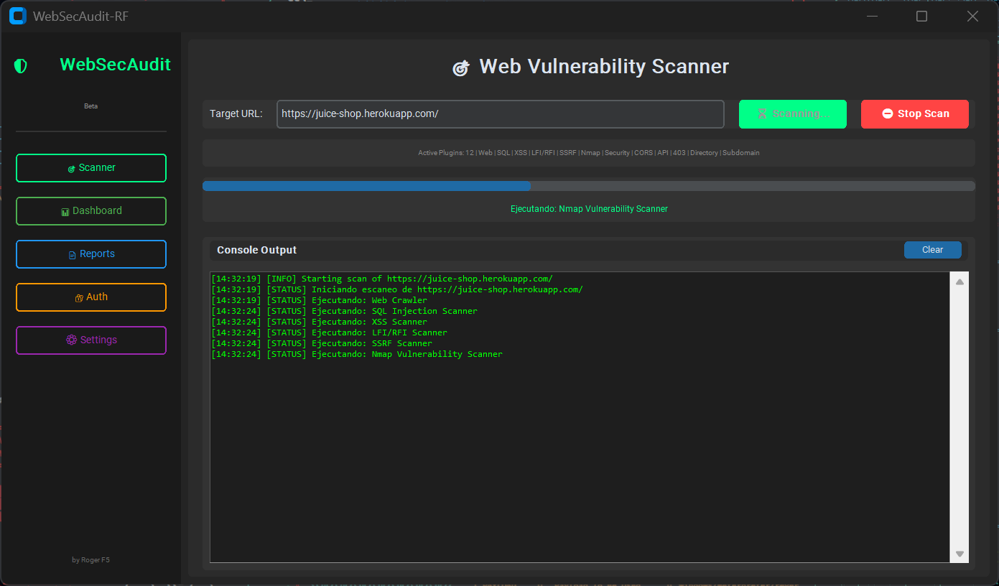
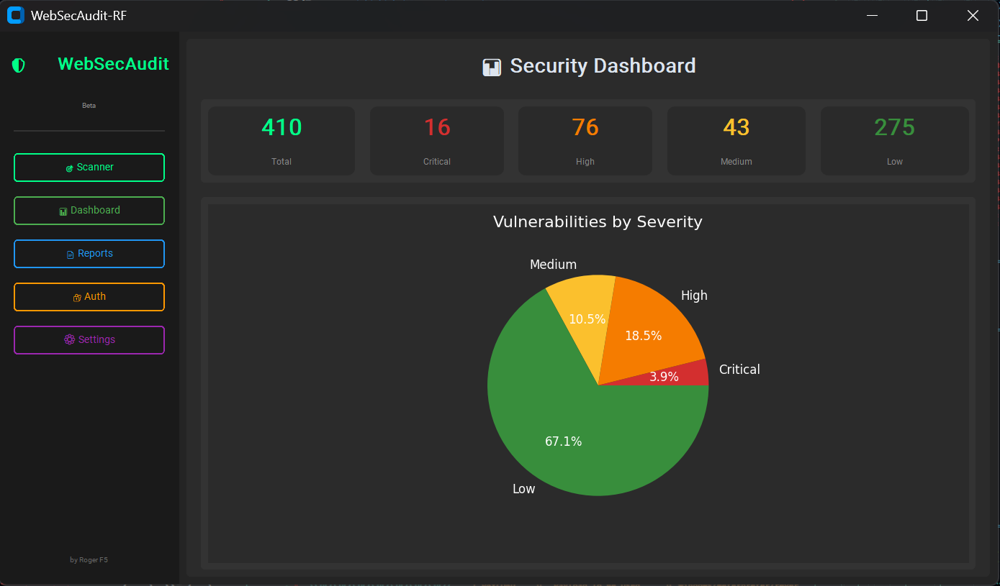
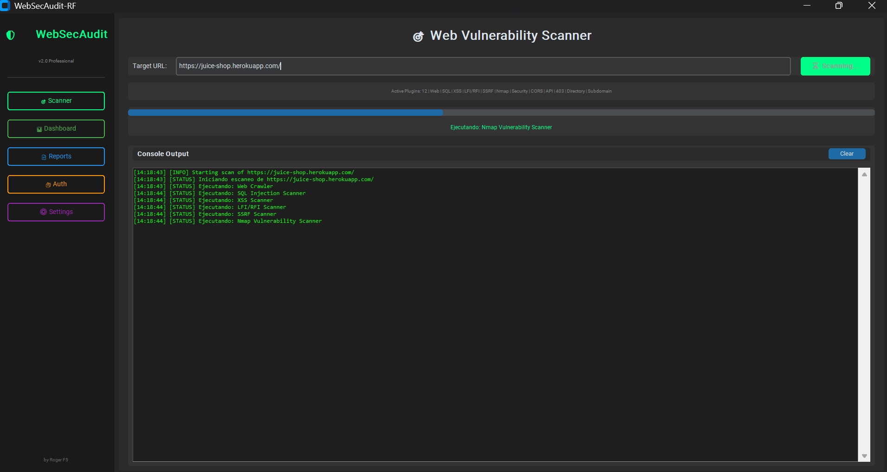
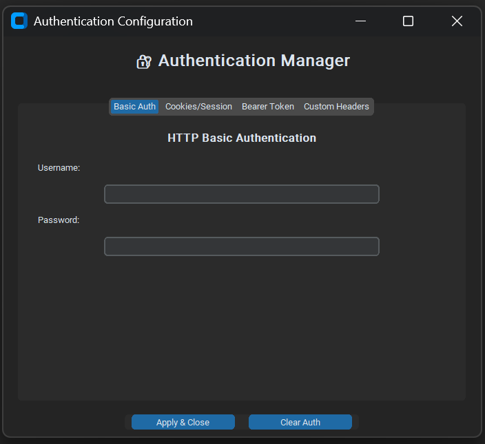
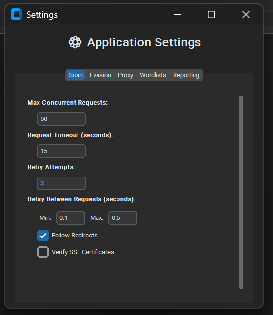
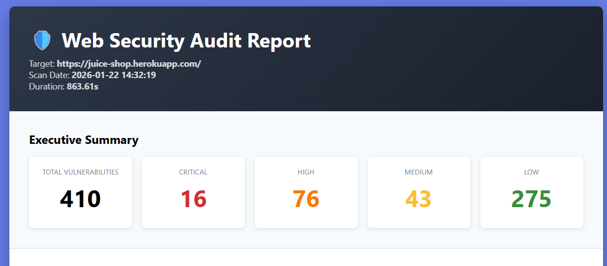

# 🛡️ WebSecAudit-RF

[](https://www.python.org/downloads/)
[](LICENSE)
[](https://github.com/RogerF5/WebSecAuditSuite)

**Suite de auditoría de seguridad web** con interfaz gráfica, detección de vulnerabilidades y generación de reportes HTML.
Desarrollado por **Roger F5 & IA** | [GitHub](https://github.com/RogerF5-Security)
---

## 📸 Galería de la Aplicación

<table>
  <tr>
    <td width="33%" valign="top">
      <h3 align="center">🏠 Home</h3>
      
      <p align="center">
        Vista principal. Punto de partida centralizado para iniciar auditorías y escaneos rápidos.
      </p>
    </td>
    <td width="33%" valign="top">
      <h3 align="center">📊 Dashboard</h3>
      
      <p align="center">
        Métricas en tiempo real. Visualización gráfica de vulnerabilidades por severidad.
      </p>
    </td>
    <td width="33%" valign="top">
      <h3 align="center">radar Scanning</h3>
      
      <p align="center">
        Terminal integrada. Muestra el progreso de inyecciones y payloads en tiempo real.
      </p>
    </td>
  </tr>
  <tr>
    <td width="33%" valign="top">
      <h3 align="center">🔐 Auth Manager</h3>
      
      <p align="center">
        Gestión de Cookies, Headers y credenciales para auditar zonas protegidas.
      </p>
    </td>
    <td width="33%" valign="top">
      <h3 align="center">⚙️ Settings</h3>
      
      <p align="center">
        Control total. Configura concurrencia, timeouts, proxys y niveles de evasión.
      </p>
    </td>
    <td width="33%" valign="top">
      <h3 align="center">📄 HTML Report</h3>
      
      <p align="center">
        Resultados profesionales. Genera informes detallados listos para presentar al cliente.
      </p>
    </td>
  </tr>
</table>

---

## 📋 Tabla de Contenidos

- [Características](#-características)
- [Instalación](#-instalación)
- [Uso Rápido](#-uso-rápido)
- [Plugins Disponibles](#-plugins-disponibles)
- [Configuración Avanzada](#-configuración-avanzada)
- [Generación de Reportes](#-generación-de-reportes)
- [Evasión WAF](#-evasión-waf)
- [Ejemplos](#-ejemplos)
- [Roadmap](#-roadmap)
- [Contribuir](#-contribuir)
- [Licencia](#-licencia)
- [Disclaimer](#%EF%B8%8F-disclaimer)

---

## ✨ Características

### 🔍 **13 Plugins de Escaneo**
- ✅ **SQL Injection** (Time-based + Error-based)
- ✅ **XSS** (Reflected + Context-aware)
- ✅ **LFI/RFI** (Local/Remote File Inclusion)
- ✅ **SSRF** (Server-Side Request Forgery)
- ✅ **403 Bypass** (50+ técnicas de evasión)
- ✅ **Directory Fuzzing** (Descubrimiento inteligente)
- ✅ **Nmap Integration** (Vulnerabilidades de infraestructura)
- ✅ **CORS Misconfiguration**
- ✅ **API Security** (REST, IDOR, Rate Limiting)
- ✅ **Security Headers Analysis**
- ✅ **Subdomain Takeover**
- ✅ **Web Crawler** (Descubrimiento automático de URLs)
- ✅ **SSL/TLS Analysis**

### 🚀 **Tecnología Avanzada**
- **Motor Async** con `aiohttp` (50+ requests concurrentes)
- **Evasión WAF/SOC**: User-Agent rotation, Jitter dinámico, Header randomization
- **Soporte Brotli Compression**
- **Proxy Support** (HTTP/HTTPS/SOCKS5)
- **Autenticación Multi-método** (Basic, Bearer, Cookies, Custom Headers)

### 📊 **Reportes Profesionales**
- **HTML5** con gráficos interactivos (matplotlib)
- **JSON** para integración con otras herramientas
- **Dashboard** en tiempo real con métricas de severidad
- **Detalles técnicos** completos (request/response, remediation, CVE, CVSS)

### 🎨 **Interfaz Gráfica Moderna**
- **Dashboard-Style** con navegación lateral
- **Consola en tiempo real** con timestamps
- **Barra de progreso** por plugin
- **Tema dark** optimizado para pentesting
- **Configuración persistente**

---

## 🚀 Instalación

### Requisitos Previos

- **Python 3.11** (entorno validado en CI; otras versiones requieren validación) ([Descargar](https://www.python.org/downloads/))
- **Nmap** (Opcional, para escaneo de infraestructura)
  - **Linux/macOS**: `sudo apt install nmap` o `brew install nmap`
  - **Windows**: [Descargar instalador](https://nmap.org/download.html)

### Instalación Rápida

```bash
# 1. Clonar repositorio
git clone https://github.com/RogerF5-Security/WebSecAudit-RF.git
cd WebSecAudit-RF

# 2. Crear entorno virtual (recomendado)
python -m venv venv

# Activar entorno virtual
# Windows:
venv\Scripts\activate
# Linux/macOS:
source venv/bin/activate

# 3. Instalar dependencias
pip install -r requirements.txt

# 4. Crear estructura de directorios
python -c "from pathlib import Path; [Path(p).mkdir(parents=True, exist_ok=True) for p in ['data/wordlists', 'data/reports', 'data/logs', 'config']]"

# 5. Copiar wordlists (opcional)
# Los wordlists básicos se generarán automáticamente

# 6. Ejecutar
python main.py
```

### Instalación Manual de Dependencias

Utiliza la lista de dependencias del repositorio para conservar las versiones validadas:

```bash
python -m pip install -r requirements.txt
python -m pip check
```

---

La comprobación de dependencias instala el archivo completo en Python 3.11, verifica
consistencia con `pip check`, compila los módulos y comprueba imports y contratos
básicos de bibliotecas sin iniciar escaneos. Se retiraron `cchardet` (no utilizado
y con error de compilación en Python 3.11) y `brotlipy` (proveedor duplicado del
módulo `brotli`); se conserva `brotli` para la descompresión HTTP.

## 🎯 Uso Rápido

### Modo Gráfico (GUI)

```bash
python main.py
```

1. **Ingresar URL objetivo** (ej: `https://example.com`)
2. Click en **"🚀 Start Scan"**
3. Ver progreso en tiempo real en la consola
4. Revisar resultados en **Dashboard**
5. Generar reporte en **Reports > Generate HTML Report**

### Configuración Básica

1. **⚙️ Settings** → Configurar:
   - Concurrent requests (default: 50)
   - Timeout (default: 15s)
   - Delay entre requests (0.1-0.5s)
   - Proxy (si es necesario)

2. **🔐 Auth** → Configurar autenticación:
   - Basic Auth
   - Bearer Token
   - Session Cookies
   - Custom Headers

---

## 🔌 Plugins Disponibles

### 1️⃣ **Web Crawler**
Descubre automáticamente URLs con parámetros para testing de inyecciones.

**Configuración:**
- `max_depth`: Profundidad de crawling (default: 2)
- `max_urls`: Máximo de URLs a descubrir (default: 50)

---

### 2️⃣ **SQL Injection Scanner**
Detecta vulnerabilidades SQLi mediante:
- **Time-based Blind**: SLEEP, BENCHMARK, WAITFOR
- **Error-based**: Patrones de error SQL en respuesta

**Técnicas:**
- Union-based detection
- Boolean-based blind
- Time-based blind (5s delay)

**Ejemplo de payload:**
```sql
' OR SLEEP(5)--
' AND 1=2--
```

---

### 3️⃣ **XSS Scanner**
Detecta Cross-Site Scripting con validación de contexto.

**Características:**
- Context detection (script, attribute, HTML body)
- Evasión de filtros básicos
- Reducción de falsos positivos

**Payloads:**
```html
<script>alert('XSS')</script>

<svg onload=alert(1)>
```

---

### 4️⃣ **403 Bypass Scanner**
Prueba **50+ técnicas** para evadir restricciones 403.

**Técnicas incluidas:**
- Path variations (`/admin/./`, `%2e/admin`)
- HTTP Headers (`X-Original-URL`, `X-Forwarded-For`)
- HTTP Methods (POST, PUT, TRACE)
- Null bytes, encoding, fragmentación

**Wordlist:** `data/wordlists/403bypass.txt`

---

### 5️⃣ **Nmap Integration**
Escanea puertos y vulnerabilidades con scripts NSE.

**Scripts ejecutados:**
- `vuln`: Detección de CVEs
- `http-waf-detect`: Detección de WAF
- `ssl-enum-ciphers`: Análisis SSL/TLS
- `http-security-headers`: Headers de seguridad

**Puertos escaneados:**
```
21, 22, 23, 25, 53, 80, 110, 443, 445, 3306, 3389, 5432, 8080, 8443, etc.
```

---

### 6️⃣ **CORS Scanner**
Detecta configuraciones CORS inseguras.

**Tests:**
- Origin reflection con credentials
- Wildcard (*) con credentials
- Null origin permitido
- Subdomain bypass

---

### 7️⃣ **API Security Scanner**
Analiza seguridad de APIs REST.

**Checks:**
- Endpoints sin autenticación
- Datos sensibles expuestos
- Rate limiting ausente
- IDOR (Insecure Direct Object Reference)
- Métodos HTTP peligrosos (PUT, DELETE)

---

### 8️⃣ **Subdomain Takeover**
Identifica subdominios vulnerables a takeover.

**Servicios detectados:**
- GitHub Pages
- Heroku
- AWS S3 / CloudFront
- Azure
- Shopify
- Fastly

---

## ⚙️ Configuración Avanzada

### Archivo de Configuración

Editar `config/user_settings.json`:

```json
{
  "scan": {
    "max_concurrent_requests": 50,
    "request_timeout": 15,
    "delay_min": 0.1,
    "delay_max": 0.5
  },
  "evasion": {
    "rotate_user_agents": true,
    "randomize_headers": true
  },
  "proxy": {
    "enabled": false,
    "url": "http://127.0.0.1:8080",
    "type": "http"
  }
}
```

### Uso con Proxy (Burp Suite)

```bash
# En Settings → Proxy
Proxy URL: http://127.0.0.1:8080
Tipo: HTTP
```

O mediante código:

```python
from gui.settings_manager import SettingsManager

settings = SettingsManager()
settings.settings["proxy"]["enabled"] = True
settings.settings["proxy"]["url"] = "http://127.0.0.1:8080"
```

### Custom Wordlists

Coloca tus wordlists en `data/wordlists/`:

```
data/wordlists/
├── directories.txt      # Fuzzing de directorios
├── 403bypass.txt        # Bypass 403
├── sqli_payloads.txt    # SQLi personalizado
└── xss_payloads.txt     # XSS personalizado
```

---

## 📄 Generación de Reportes

### Reporte HTML

```python
# Automático tras escaneo
Reports → "Generate HTML Report"
```

**Incluye:**
- ✅ Executive Summary con gráficos
- ✅ Vulnerabilidades por severidad (CRITICAL, HIGH, MEDIUM, LOW)
- ✅ Detalles técnicos: Request/Response, Payload, Remediation
- ✅ CVE, CWE, CVSS Score
- ✅ Timestamps y metadata del escaneo

**Ubicación:** `data/reports/audit_report_YYYYMMDD_HHMMSS.html`

### Reporte JSON

```python
Reports → "Export JSON"
```

**Estructura:**
```json
{
  "target": "https://example.com",
  "scan_stats": {
    "duration": 125.5,
    "total_requests": 850,
    "vulnerabilities_found": 12
  },
  "summary": {
    "critical": 2,
    "high": 5,
    "medium": 3,
    "low": 2
  },
  "findings": [...]
}
```

---

## 🔒 Evasión WAF

### Técnicas Implementadas

#### 1. **User-Agent Rotation**
```python
# Automático - 10+ User-Agents reales rotados
Mozilla/5.0 (Windows NT 10.0; Win64; x64) AppleWebKit/537.36...
Mozilla/5.0 (Macintosh; Intel Mac OS X 10_15_7)...
```

#### 2. **Jitter Dinámico**
```python
# Delay aleatorio entre 0.1s - 0.5s entre requests
delay = random.uniform(0.1, 0.5)
```

#### 3. **Header Randomization**
```python
# Headers aleatorios por request
Accept-Language: en-US,en;q=0.9
DNT: 1
Sec-Fetch-Mode: navigate
```

#### 4. **Case Mutation (SQLi)**
```python
# Activar en Settings → Evasion
' OR SLEEP(5)--
' oR sLeEp(5)--
```

#### 5. **Path Encoding**
```python
/admin       → Normal
%2e/admin    → Dot encoding
/admin/./    → Path traversal
admin..;/    → Semicolon bypass
```

---

## 💡 Ejemplos

### Escaneo Básico

```bash
# 1. Iniciar aplicación
python main.py

# 2. Ingresar URL
URL: https://testphp.vulnweb.com

# 3. Start Scan
# Esperar 2-5 minutos

# 4. Ver resultados en Dashboard
```

### Escaneo con Autenticación

```bash
# 1. Click en "🔐 Auth"
# 2. Seleccionar "Bearer Token"
# 3. Ingresar token:
Token: eyJhbGciOiJIUzI1NiIsInR5cCI6IkpXVCJ9...

# 4. Apply & Close
# 5. Start Scan
```

### Escaneo via Proxy (Burp)

```bash
# 1. Configurar Burp Suite en puerto 8080
# 2. Settings → Proxy
Proxy URL: http://127.0.0.1:8080
Enable: ✓

# 3. Start Scan
# 4. Ver requests en Burp HTTP History
```

### Bypass 403 Manual

```bash
# Crear wordlist personalizada
echo "admin" > data/wordlists/403bypass.txt
echo "%2e/admin" >> data/wordlists/403bypass.txt
echo "admin -H X-Original-URL: admin" >> data/wordlists/403bypass.txt

# Ejecutar escaneo
# El plugin Bypass403Scanner cargará automáticamente
```

---

## 🗺️ Roadmap

### v2.1 (Q2 2026)
- [ ] JWT Security Scanner
- [ ] GraphQL Introspection
- [ ] WebSocket Security
- [ ] Server-Side Template Injection (SSTI)
- [ ] XML External Entity (XXE)

### v2.2 (Q3 2026)
- [ ] Integración con Nuclei templates
- [ ] Machine Learning para detección de falsos positivos
- [ ] Plugin de reporting a Jira/Slack
- [ ] API REST para integración CI/CD

### v3.0 (Q4 2026)
- [ ] Modo headless (CLI completo)
- [ ] Distributed scanning (multi-worker)
- [ ] Plugin marketplace
- [ ] Cloud deployment (Docker/Kubernetes)

---

## 🤝 Contribuir

¡Las contribuciones son bienvenidas! 

### Cómo contribuir:

1. **Fork** el repositorio
2. **Crea** una rama para tu feature (`git checkout -b feature/AmazingFeature`)
3. **Commit** tus cambios (`git commit -m 'Add some AmazingFeature'`)
4. **Push** a la rama (`git push origin feature/AmazingFeature`)
5. **Abre** un Pull Request

### Desarrollo de Plugins

Para crear un nuevo plugin:

```python
from plugins.base_plugin import BasePlugin, Finding

class MyScanner(BasePlugin):
    def __init__(self):
        super().__init__(
            name="My Scanner",
            description="Description here"
        )
    
    async def scan(self, target_url: str, client, **kwargs):
        # Tu lógica aquí
        response = await client.get(target_url)
        
        # Crear finding
        finding = Finding(
            plugin_name=self.name,
            severity="HIGH",
            title="Vulnerability Found",
            description="Details...",
            url=target_url,
            remediation="Fix it like this..."
        )
        
        self.add_finding(finding)
        return self.findings
```

---

## 📜 Licencia

Este proyecto está bajo la licencia **MIT**. Ver archivo [LICENSE](LICENSE) para más detalles.

```
MIT License

Copyright (c) 2026 Roger F5

Permission is hereby granted, free of charge, to any person obtaining a copy
of this software and associated documentation files (the "Software"), to deal
in the Software without restriction...
```

---

## ⚠️ Disclaimer

**WebSecAuditSuite** es una herramienta de **auditoría de seguridad** diseñada para profesionales y equipos de seguridad autorizados.

### ⚖️ Uso Legal

- ✅ **PERMITIDO**: Auditorías autorizadas, Bug Bounty, pentesting con permiso
- ❌ **PROHIBIDO**: Ataques no autorizados, acceso ilegal, daño a sistemas

### Responsabilidad

- El autor **NO se responsabiliza** del uso indebido de esta herramienta
- El usuario es **totalmente responsable** de sus acciones
- **SIEMPRE** obtén autorización por escrito antes de escanear
- Cumple con las leyes locales e internacionales (CFAA, GDPR, etc.)

### Targets de Prueba Legales

- [OWASP Juice Shop](https://juice-shop.herokuapp.com)
- [Damn Vulnerable Web Application](http://www.dvwa.co.uk)
- [HackTheBox](https://www.hackthebox.eu)
- [TryHackMe](https://tryhackme.com)

---

## 🌟 Agradecimientos

- **Anthropic Claude** - Asistencia en desarrollo
- **OWASP** - Frameworks de seguridad

---

## 📊 Estadísticas del Proyecto


---

<div align="center">

**⭐ Si te gusta este proyecto, dale una estrella en GitHub ⭐**

**Hecho con ❤️ por Roger F5**

</div>
